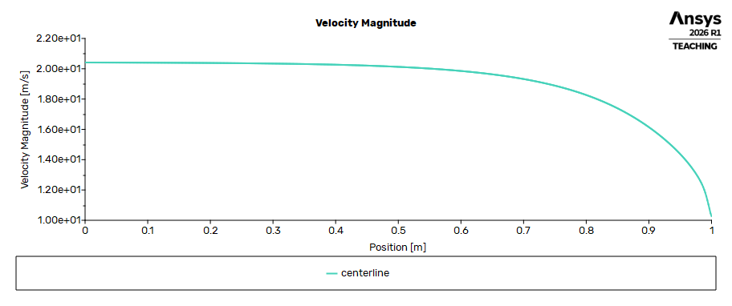
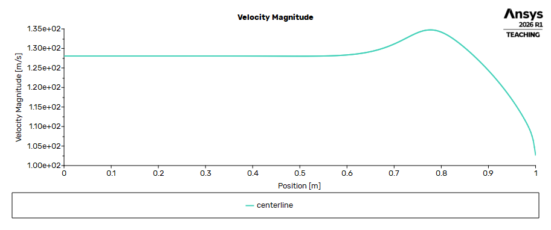
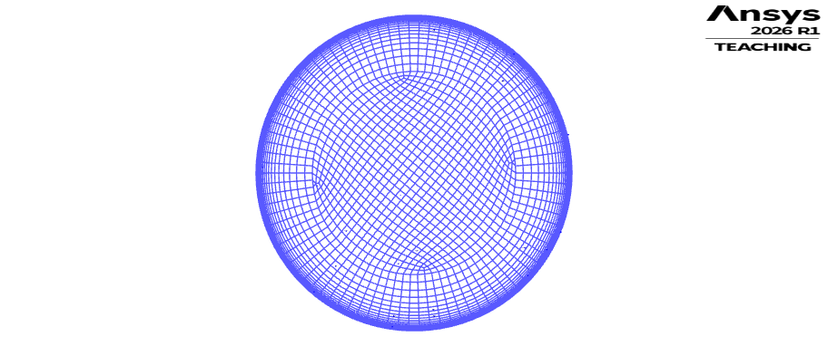
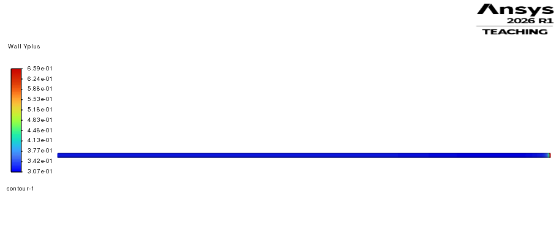

# KIG2014 Fluid Mechanics II — CFD Assignment

An ANSYS Fluent coursework project for **KIG2014: Fluid Mechanics II, Universiti Malaya**: laminar and turbulent hydrogen flow through a straight circular pipe.

I am sharing my modelling workflow, mesh settings and simulation results to help future students getting started with a similar CFD assignment. I hope this makes the first encounter with Workbench and Fluent a little less confusing!

This is a student coursework record, with a mesh study of **four laminar meshes (M1–M4)** and **five turbulent meshes (M1–M5)**. It is not an official university solution or marking guide.

## Start here

1. Read the [reproduction guide](docs/REPRODUCE.md) for the geometry, boundary conditions and meshing workflow.
2. Browse [laminar results](results/laminar) or [turbulent results](results/turbulent). Every mesh has its own parameter file, numerical results and exported figures.
3. Read the [results notes](docs/RESULTS_NOTES.md) before comparing pressure drops or writing about mesh independence.
4. [Download the full Fluent case/data/mesh archive](https://github.com/Tonylo-lab/KIG2014-Fluid-Mechanics-II-CFD-Assignment/releases/download/v1.0.0/KIG2014_CFD_Fluent_Files.zip) (340.45 MiB; 27 files across all nine runs). See the [loading instructions and checksum](docs/SOLVER_FILES.md), or browse [release v1.0.0](https://github.com/Tonylo-lab/KIG2014-Fluid-Mechanics-II-CFD-Assignment/releases/tag/v1.0.0).

## Case setup

| Parameter | Value |
|---|---|
| Software | ANSYS Workbench / Fluent 2026 R1, 3D, double precision |
| Geometry | Straight circular fluid domain, diameter 0.010 m, length 1.000 m |
| Fluid | Hydrogen, constant density 0.08189 kg/m³ and dynamic viscosity 8.411 × 10⁻⁶ Pa·s |
| Laminar case | Re ≈ 1,000; uniform inlet speed 10.271 m/s |
| Turbulent case | Re ≈ 10,000; uniform inlet speed 102.711 m/s; SST k–ω |
| Turbulence boundary input | Intensity 5.06%; hydraulic diameter 0.010 m |
| Outlet | Pressure outlet, gauge pressure 0 Pa |
| Wall | Stationary, no slip |
| Solver | Steady, pressure based, SIMPLE; second-order pressure and second-order upwind transport |
| Final residuals | All monitored equations below 10⁻⁶ in every saved run |

**Coordinate convention:** the inlet is at **Z = 1 m**, the outlet at **Z = 0 m**, and flow travels in the **negative Z direction**. A pressure curve that rises with increasing Z is therefore consistent with the setup. The original boundary names are `inlert`, `outlert` and `wall` (including the original spelling).

## Recorded results

| Flow | Mesh | Cells | Axial divisions | Full-pipe Δp (Pa) | Developed Δp, 0.20 m (Pa) | Mean wall y⁺ |
|---|---|---:|---:|---:|---:|---:|
| Laminar | M1 | 15,400 | 200 | 32.133 | 5.482 | — |
| Laminar | M2 | 49,500 | 300 | 32.596 | 5.515 | — |
| Laminar | M3 | 114,000 | 400 | 32.781 | 5.529 | — |
| Laminar | M4 | 343,200 | 600 | 32.930 | 5.539 | — |
| Turbulent | M1 | 15,400 | 200 | 1465.550 | 286.724 | 31.437 |
| Turbulent | M2 | 49,500 | 300 | 1456.026 | 282.303 | 21.377 |
| Turbulent | M3 | 114,000 | 400 | 1459.259 | 281.868 | 16.448 |
| Turbulent | M4 | 343,200 | 600 | 1470.678 | 283.372 | 12.157 |
| Turbulent | M5 | 984,800 | 400 | 1455.420 | 280.768 | 0.318 |

The developed-flow comparison uses cross-section area-weighted pressures at **Z = 0.30 m and Z = 0.10 m**, with a separation of **0.20 m**. Full-pipe pressure loss also includes the entrance region. Use a matching length and flow region when doing a theoretical comparison.

### Near-wall refinement in turbulent M5

M5 adds inflation with a nominal first-layer height of **0.01 mm**, growth rate **1.2**, and requested maximum **20 layers**. The resulting wall y⁺ is **0.307–0.659**, with an area-weighted mean of **0.318**; the entire saved wall surface has y⁺ < 1.

M5 uses **400 axial divisions**, compared with **600 in M4**, to stay within the active Fluent cell limit. It has 984,800 cells (984,000 hexahedra and 800 wedges). This is a targeted near-wall refinement: the M4-to-M5 comparison changes both wall-normal and axial resolution. It is not a refinement of every mesh direction at once.

## Example figures

| Laminar M4 centerline velocity | Turbulent M5 centerline velocity |
|---|---|
|  |  |

| Turbulent M5 cross-section mesh | Turbulent M5 wall y-plus |
|---|---|
|  |  |

## Files included

- `geometry/`: the original SolidWorks part and Parasolid fluid-domain geometry.
- `results/<flow>/<mesh>/model_parameters.txt`: model and mesh settings.
- `results/<flow>/<mesh>/calculation_results.txt`: residuals, pressure drops, mass balance and other recorded outputs.
- `results/<flow>/<mesh>/*.png`: original Fluent/Meshing exports, eight per laminar mesh and nine per turbulent mesh.
- `results/<flow>/<mesh>/*.out`: inlet pressure monitor history.
- `results/mesh_summary.json`: numerical summary transcribed from the per-run records.

Large `.cas.h5`, `.dat.h5` and `.msh` files are distributed separately rather than tracked in the repository. Workbench temporary files, solver executables and software installers are not part of this project.

The theoretical validation, formal grid-convergence assessment and final group report are not included in this initial public package. The tables above report CFD results; they do not by themselves establish grid independence.

## For future students

Start with one coarse mesh, check the model and boundaries, and save a case/data pair for every run. Check pressure history and mass conservation along with residuals. For turbulent flow, inspect wall y⁺ after solving; a finer-looking global mesh alone does not demonstrate adequate near-wall resolution.

Your assignment may use a different fluid, Reynolds number, geometry or turbulence model. Adapt the settings and verify your own results. If you spot a mistake or find a clearer way to explain a step, suggestions and issues are welcome.

## References

- [ANSYS Fluent 2026 R1: monitoring solution convergence](https://ansyshelp.ansys.com/public/views/secured/corp/v261/en/flu_ug/flu_ug_sec_solve_monitor.html)
- [ANSYS Meshing 2026 R1: inflation controls with sweeping](https://ansyshelp.ansys.com/public/Views/Secured/corp/v261/en/wb_msh/msh_specialized_inflation.html)
- [ANSYS Fluent 2026 R1: near-wall treatment for omega-based models](https://ansyshelp.ansys.com/public/views/secured/corp/v261/en/flu_th/section_kbf_dl4_vvb.html)

The repository contains my own project files and exported results. The course assignment brief and teaching slides are not redistributed here.
